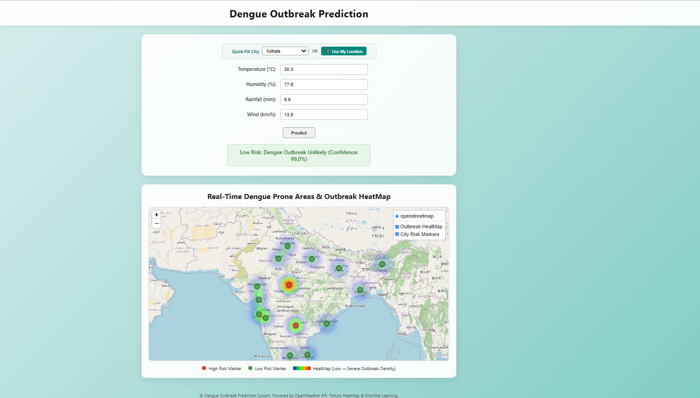

# Dengue Outbreak Prediction 🌦️🦟 <Python/Flask>

This application predicts the likelihood of a dengue outbreak based on meteorological conditions using a pre-trained machine learning model and real-time weather data. The app visualizes predictions and regional risk gradients on an interactive map of India with Folium HeatMaps.

## Features

- **Asynchronous Instant Predictions**: Fast JSON `/api/predict` endpoint without full-page reloads.
- **One-Click Weather Auto-Fill**:
  - **Quick-Fill City Dropdown**: Instantly retrieves live weather for 16 major Indian metropolitan cities.
  - **📍 Use My Location**: Uses HTML5 Geolocation to fetch live weather at the user's GPS coordinates.
- **Folium Interactive Map & HeatMap**:
  - Color-coded city markers (Green for Low Risk, Red for Dengue Prone).
  - Outbreak density HeatMap layer with interactive layer toggling.
- **In-Memory Caching (`Flask-Caching`)**: Caches OpenWeather API queries for 30 minutes to stay within free-tier rate limits and speed up page load times to <30ms.
- **Production-Ready**: Dockerized with multi-worker Gunicorn WSGI and environment configuration.

---

## 🚀 Quick Start with Docker (Recommended)

1. **Clone the repository**:
   ```bash
   git clone https://github.com/yourusername/dengue-prediction-app.git
   cd dengue-prediction-app
   ```

2. **Configure Environment Variables**:
   Copy the example environment file:
   ```bash
   cp .env.example .env
   ```
   Edit `.env` and set your `OPENWEATHER_API_KEY`.

3. **Launch with Docker Compose**:
   ```bash
   docker-compose up --build -d
   ```
   Open your browser at `http://localhost:5000/`.

---

## 💻 Local Setup (Without Docker)

### Prerequisites
- Python 3.8+
- Active OpenWeather API key (optional; fallback regional simulation is included)

### Installation

1. **Create and activate a virtual environment**:
   ```bash
   python3 -m venv venv
   source venv/bin/activate  # On Windows: venv\Scripts\activate
   ```

2. **Install dependencies**:
   ```bash
   pip install -r requirements.txt
   ```

3. **Configure Environment**:
   ```bash
   cp .env.example .env
   ```

4. **Run the Application**:
   ```bash
   python app.py
   ```
   Access the app at `http://127.0.0.1:5000/`.

---

## Screenshots


---

## 📁 Project Structure

```
├── app.py                # Main Flask web application & API routes
├── dengue_model.pkl      # Pre-trained machine learning model
├── requirements.txt      # Python dependencies
├── Dockerfile            # Container definition (Gunicorn WSGI)
├── docker-compose.yml    # Multi-container orchestration config
├── .env.example          # Environment variables template
├── .env                  # Local environment file (git-ignored)
├── .gitignore            # Git exclusion rules
├── .dockerignore         # Docker build exclusion rules
├── templates/
│   └── index.html        # Responsive frontend template with AJAX logic
├── static/
│   └── style.css         # Styling, buttons, status notices, and legend
└── image.png             # Application preview screenshot
```

---

## 🛡️ License & Contributing

Feel free to open issues, submit pull requests, or propose new features!
